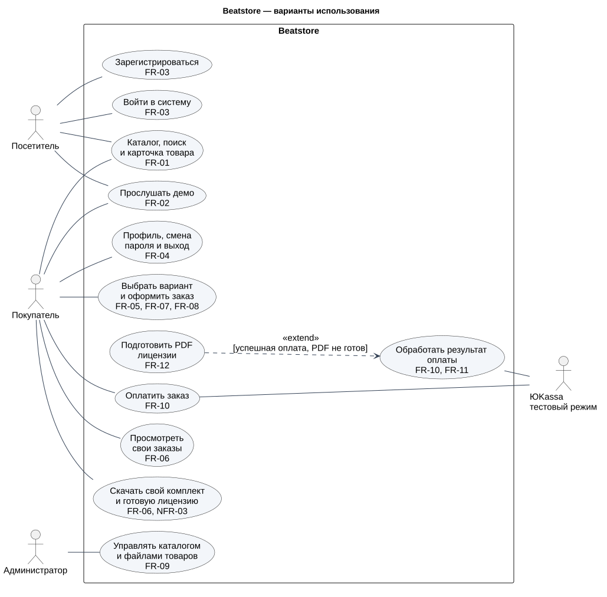
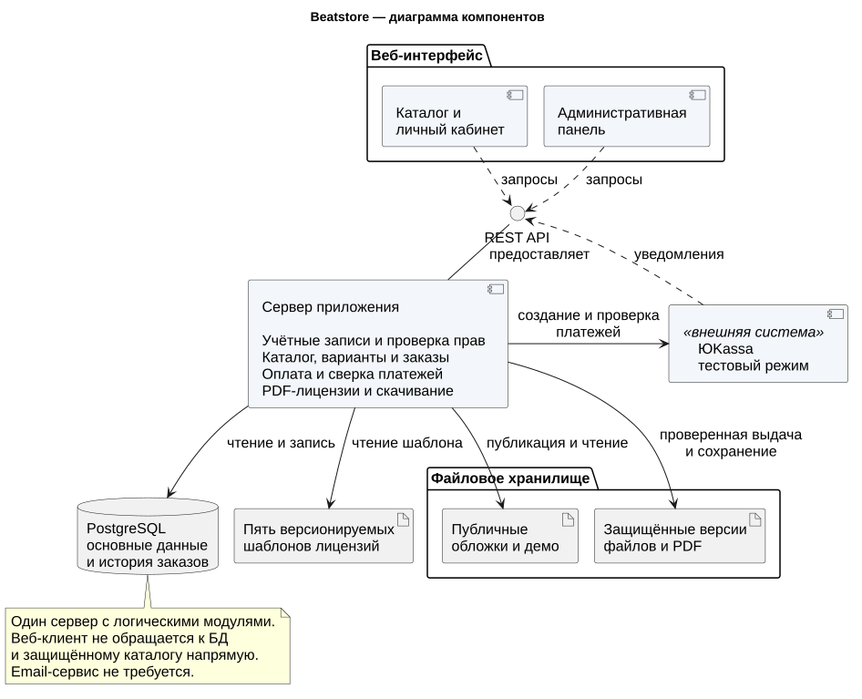
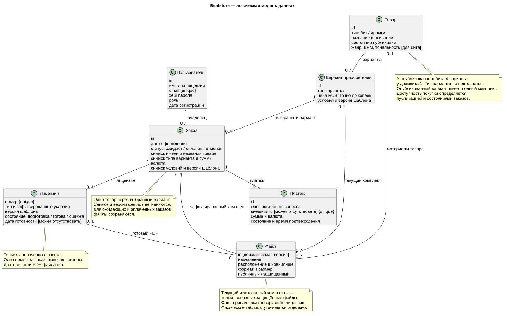
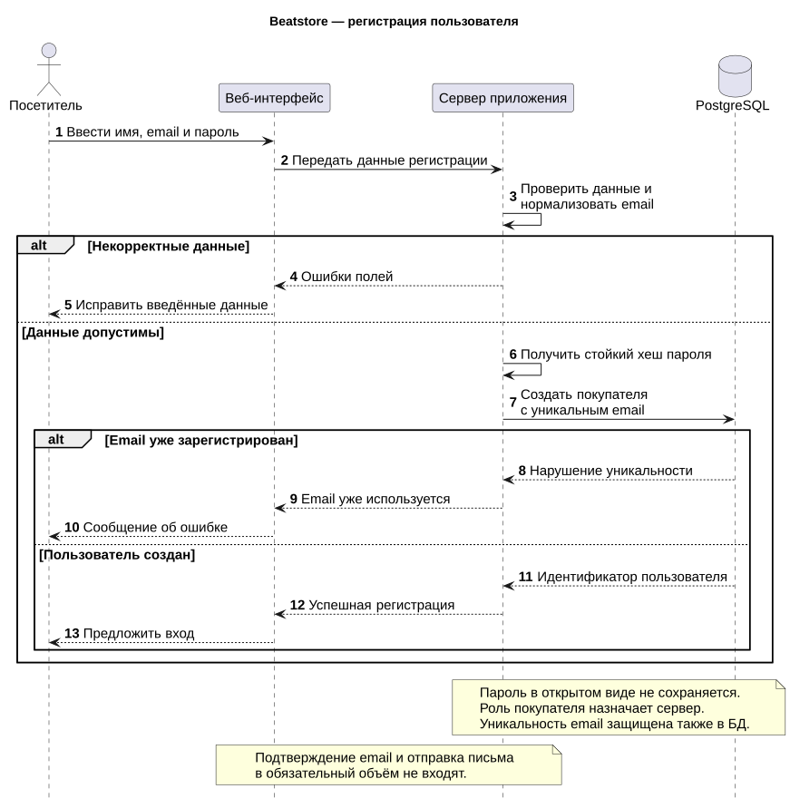
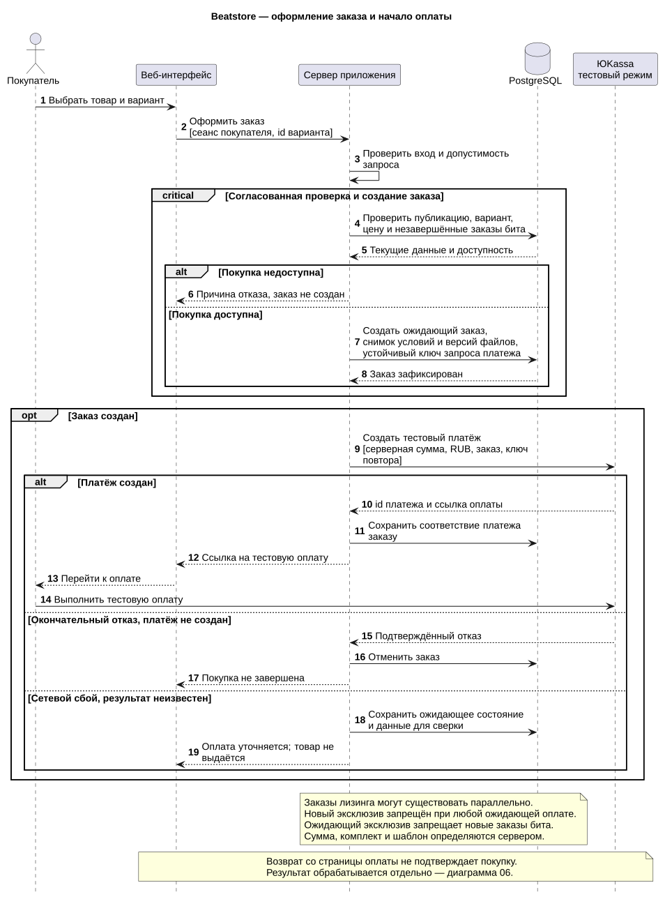
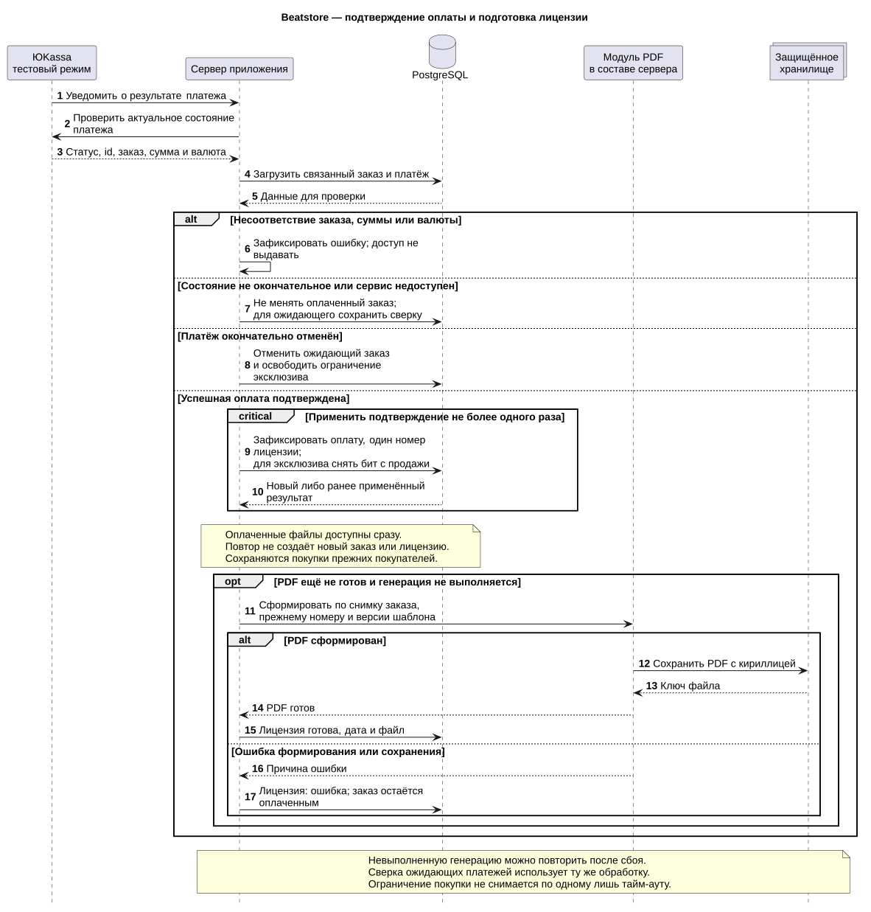
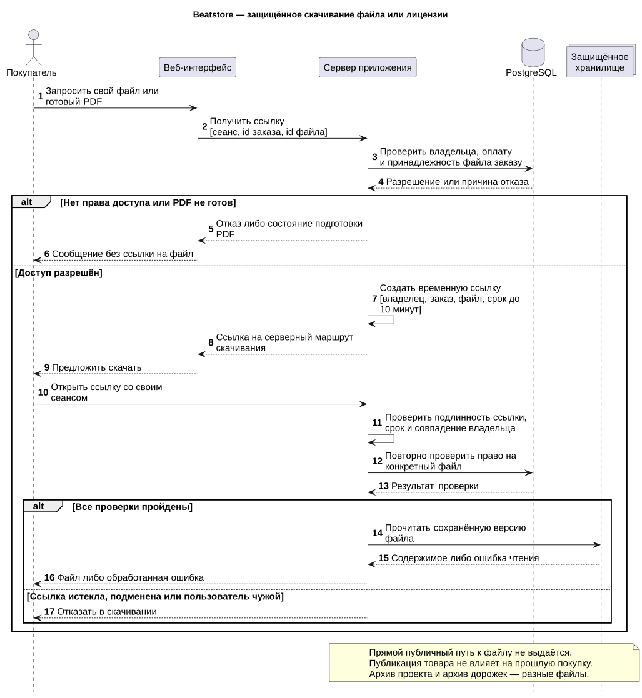
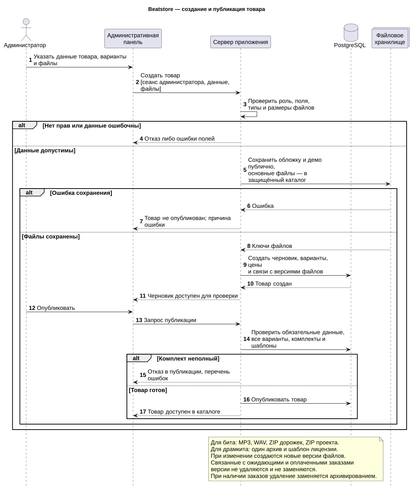

# UML диаграммы Beatstore

Диаграммы отражают актуальное ТЗ. SVG используются для просмотра и масштабирования, файлы PlantUML — для редактирования. [Все диаграммы в одном PDF](../Beatstore-UML-sprint-2.pdf).

## 1 Варианты использования

Обзор функций посетителя, покупателя, администратора и взаимодействия с ЮKassa. Подготовка лицензии расширяет обработку результата оплаты при подтверждённом успехе; она не выполняется для отменённого платежа.

[SVG](01-use-cases.svg) · [PlantUML](01-use-cases.puml)

## 2 Компоненты

Актуализирована диаграмма прошлого семестра. Сервер — одно приложение с логическими модулями; выделенные микросервисы не требуются. Общий REST API используется пользовательским и административным интерфейсами. Внешняя платёжная система работает в тестовом режиме.

[SVG](02-components.svg) · [PlantUML](02-components.puml)

## 3 Логическая модель данных

Уточняет раздел 5 ТЗ. Кратности описывают связи понятий, а не число физических таблиц. Черновик может быть неполным; перед публикацией проверяются четыре варианта бита или один вариант драмкита и их комплекты. Снимок заказа ссылается на конкретные версии файлов. PDF появляется только после успешного формирования лицензии.

[SVG](03-data-model.svg) · [PlantUML](03-data-model.puml)

## 4 Регистрация

Сохранены посетитель, веб-интерфейс, сервер и PostgreSQL. Email-сервис исключён. Показаны ошибки данных и повторного email, назначение роли и хранение хеша пароля.

[SVG](04-registration.svg) · [PlantUML](04-registration.puml)

## 5 Оформление заказа

Первая часть актуализированного сценария покупки: выбор варианта, согласованная проверка доступности, фиксация снимка заказа, создание тестового платежа и переход к оплате. При сетевой ошибке с неизвестным результатом заказ не отменяется автоматически.

[SVG](05-checkout.svg) · [PlantUML](05-checkout.puml)

## 6 Подтверждение оплаты и лицензия

Вторая часть покупки: подтверждение сервером, проверка суммы и валюты, защита от повторов, снятие эксклюзива с продажи и формирование PDF. Модуль PDF входит в тот же сервер. Его ошибка сохраняет оплату и доступ к основным файлам. Проверка ожидающего платежа и повторная генерация используют те же правила.

[SVG](06-payment-and-license.svg) · [PlantUML](06-payment-and-license.puml)

## 7 Скачивание

Актуализирован существующий сценарий скачивания. Временная ссылка ведёт на серверный маршрут, где повторно проверяются сеанс владельца, срок и право на конкретный файл. Публичные демо не проходят через этот сценарий.

[SVG](07-download.svg) · [PlantUML](07-download.puml)

## 8 Создание и публикация товара

Актуализирована диаграмма добавления товара. Проверяются права администратора и файлы; товар сохраняется как черновик и публикуется после проверки полноты. Правила редактирования и удаления отражены примечанием и задачей DEV-23.

[SVG](08-admin-product.svg) · [PlantUML](08-admin-product.puml)

## Редактирование

Названия сообщений описывают операции системы, а не окончательные адреса API. После изменения `.puml` необходимо обновить SVG и общий PDF. Достаточно локального PlantUML; точные версии и способ локального рендеринга зафиксированы в файле `rendering.md`.
